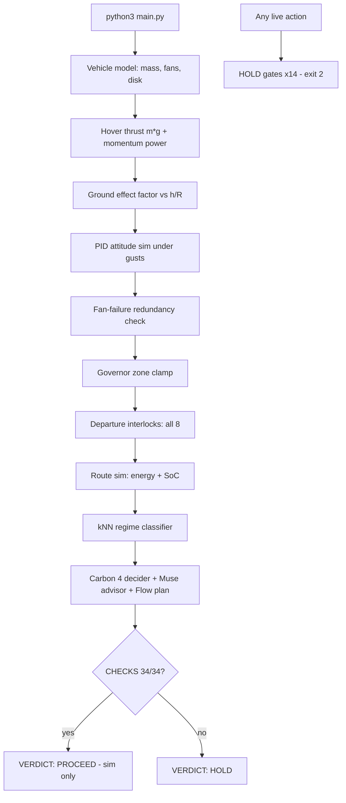
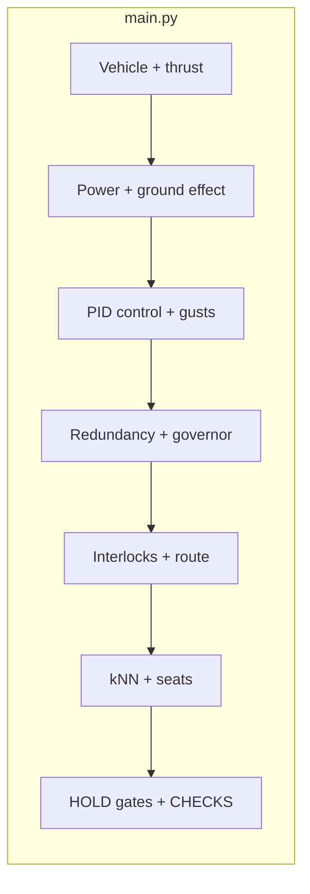
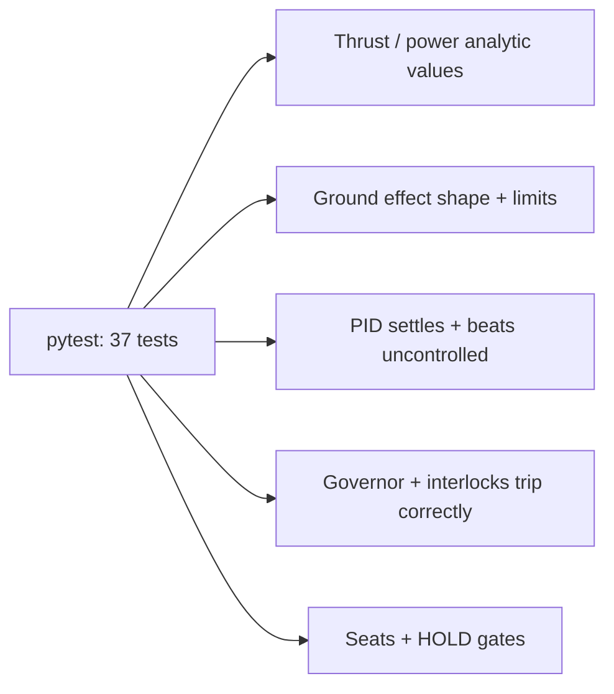
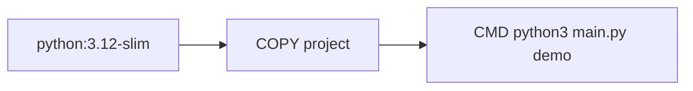

# 🛸 HoverX — Personal Hover Vehicle Autopilot Lab

> **A SIM-ONLY personal hover vehicle autopilot lab in pure Python stdlib: ducted-fan + tilt-rotor physics, ground effect, PID gust rejection, a zone governor, RVx-style departure interlocks, and 14 HOLD gates. Nothing here flies anything real.**
>
> 👨‍💻 By Darion Kellar · 📜 MIT License · 🐍 Pure stdlib · 🌐 Zero network

---

## ❓ What is this about?

HoverX completes the **X transportation family**:

| Member | World |
|---|---|
| ✈️ Flightx | Air |
| 🛥️ YachtX | Water |
| 🚐 RVx | Road |
| 🌀 TeleportX | Teleport |
| 🛸 **HoverX** | **Low altitude — the hover layer between road and air** |

It is a working physics and control lab for a personal hover vehicle — the kind of ducted-fan / tilt-rotor machine now being prototyped as air taxis — built the way an engineer would sanity-check one on paper before anyone bends metal: How much thrust does hover actually take? How much power? What does the ground do to you in the last metre? Can the autopilot hold attitude in gusts? Can it still hover with a fan dead? What should the governor never let it do, and what must be true before it is even allowed to lift — in simulation?

Every answer is computed from real formulas and asserted in CHECKS against analytic values. And because a hover vehicle carries people, the lab is strict about its boundary: **simulation only, forever**. Live flight, live control, live passengers and 11 more live actions sit behind HOLD gates that nothing in the code — including the AI seats — can lift.

---

## 🛠️ Tech Stack & Full Architecture

### 💻 Core Language & Runtime

-brightgreen)


### 🧮 Physics & Control


### 🧠 Advisory Seats (names-only, never override a HOLD)


-34A853)

### 🐳 Container & CI


> ⚠️ Workflow badges are static **Pending Paste** shields on purpose: `ci.yml` and `docker-publish.yml` are delivered in the workflow paste pack and have not been pasted into `.github/workflows/` yet, so no live badge exists to show. The Docker image tag they will publish is `credkellar/hoverx:latest`.

### 🧪 Testing


### 🌐 Web3 & Cloud
None — honestly none. HoverX runs fully offline in one file; there is no chain, no cloud call, and no account involved.

### 🏗️ Architecture in one line
ONE `main.py` holds the vehicle model, physics, control loop, governor, interlocks, route sim, classifier and seats — so the whole machine can be read, run and audited in one sitting.

---

## ⚙️ What this does — step by step

1. 🚁 **Builds the vehicle** — 8 ducted tilt fans (R = 0.55 m), empty mass 320 kg, payload up to 160 kg, 42 kWh pack.
2. ⚖️ **Computes hover thrust** — T = m·g, shared evenly per fan, with disk area and disk loading.
3. 🔋 **Prices the hover** — momentum theory P = T^(3/2) / √(2ρA), divided by a 0.72 figure of merit → 83.6 kW at 415 kg, ≈24 min endurance.
4. 🌬️ **Applies ground effect** — a Cheeseman-Bennett style factor: ×1.163 thrust at one rotor radius, fading to ×1.000 high up; IGE power < OGE power.
5. 🎛️ **Stabilizes attitude** — a PID loop holds roll against a deterministic gust-torque profile: max deviation 6.00° (the initial shove) vs 100.92° uncontrolled, settling to 0.302°.
6. 🔁 **Tests redundancy** — one fan out at cruise payload: still hovers (6,650 N ≥ 4,477 N needed with margin). Three out at max payload: cannot (4,750 N < 5,178 N) — the lab says so plainly.
7. 🚦 **Governs by zone** — PAD 2 m/s / 3 m, NEIGHBORHOOD 8 m/s / 30 m, CORRIDOR 25 m/s / 120 m, TEST_AREA 35 m/s / 150 m, plus a 150 m absolute ceiling. Requests above a cap are clamped, never granted.
8. ✅ **Checks departure interlocks** — battery ≥ 30%, fan health (N-1 allowed), CG within ±0.08 m, payload within limit, wind ≤ 12 m/s, clear zone, doors latched, governor set. ALL must pass.
9. 🗺️ **Flies the route — on paper** — a 6.7 km Porter Ranch hop (Town Center → Limekiln Canyon overlook → home): 7.1 min total, SoC 92% → 72%.
10. 🧠 **Classifies the regime** — a stdlib kNN labels conditions safe / marginal / no-go from wind, payload fraction and SoC (100% self-accuracy on its training set).
11. 🪑 **Consults the seats** — Carbon 4 decides (tighten-only, sha256 trace), Muse advises (can_override_hold = False), Flow plans 5 shots (rendered = False, live = 0).
12. 🛑 **Runs CHECKS** — 34 assertions against analytic values, then prints the VERDICT.

---

## 📊 How this works — mermaid per script

### 🗺️ Master flow



### 📜 main.py — the whole lab



### 🧪 tests/test_main.py — proof, not promises



### 🐳 Dockerfile — the container



### 🎨 assets/cover.png — the cover


---

## 😎 Why is this cool? — 10 reasons

1. 🛸 It completes the X transportation family — road, water, air, teleport, and now hover.
2. 🧮 The physics is real: momentum theory, m·g thrust and ground effect, all asserted against analytic answers.
3. 🌬️ Ground effect is modelled, not hand-waved — you can watch the last rotor-radius do its work.
4. 🎛️ The PID genuinely rejects gusts: 6.00° max deviation vs 100.92° with the loop off.
5. 🔁 It tells the truth about failure: three fans out at max payload = no hover, in numbers.
6. 🚦 The governor is a citizen: neighbourhoods get 8 m/s and 30 m, not whatever the pilot asked for.
7. ✅ RVx-style interlocks mean the sim cannot "take off" unbalanced, undercharged, or in high wind.
8. 🔋 Energy is honest bookkeeping — the Porter Ranch hop lands at 72% SoC, above the 30% floor, or the route fails.
9. 🛑 14 HOLD gates make "sim-only" a property of the code, not a promise in the README.
10. 📦 One stdlib file: no installs, no accounts, no network — `python3 main.py` and the whole lab runs.

---

## 🧩 What problems this solves — 10 problem → solution pairs

1. **Problem:** Hover-vehicle hype quotes thrust and range with no math shown. → **Solution:** Every headline number here is derived from a named formula and re-asserted in CHECKS.
2. **Problem:** Ground effect surprises pilots at touchdown. → **Solution:** A height-vs-benefit curve makes the effect visible and priced into power before "flight."
3. **Problem:** "It has 8 fans, so it's redundant" is a slogan, not a check. → **Solution:** The N-1 / N-3 test computes available vs needed thrust with a safety margin.
4. **Problem:** Autopilot demos hide the uncontrolled case. → **Solution:** The same gust profile runs with the PID off — 100.92° — so the loop's value is measured, not claimed.
5. **Problem:** Speed and altitude creep in low-altitude flight. → **Solution:** Zone governor caps with an absolute ceiling clamp every request.
6. **Problem:** Departures happen with a low battery or a shifted load. → **Solution:** Eight interlocks, all must pass, each with a named failure the tests trip on purpose.
7. **Problem:** Range claims ignore hover segments. → **Solution:** The route sim charges lift-off and landing hover time against the same pack as cruise.
8. **Problem:** "Is today a good day to fly?" gets a gut-feel answer. → **Solution:** A kNN classifier turns wind / payload / SoC into safe, marginal, or no-go.
9. **Problem:** AI advisors quietly become decision-makers. → **Solution:** Carbon 4 can only tighten to HOLD, Muse can never override one, Flow never renders live.
10. **Problem:** Sim code drifts toward real control. → **Solution:** 14 HOLD gates — live flight, hardware, passengers, airspace — return HOLD with exit 2, permanently.

---

## 📥 How to install — step by step

1. 🐍 Install Python 3.12 (or any Python 3.10+ — stdlib only, nothing else to install).
2. 📥 Clone or download this repo and open a terminal in its folder.
3. ▶️ Run the lab:
   ```bash
   python3 main.py
   ```
   You should see the 10-section demo, **CHECKS: 34/34**, **VERDICT: PROCEED**.
4. 🛑 Try a HOLD gate:
   ```bash
   python3 main.py hold-demo
   ```
   Expected: `HOLD: live_flight` and exit code 2.
5. 🧪 (Optional) Run the test suite:
   ```bash
   pip install pytest
   pytest -q
   ```
   Expected: **37 passed**.
6. 🐳 (Optional) Run it in Docker:
   ```bash
   docker build -t credkellar/hoverx:latest .
   docker run --rm credkellar/hoverx:latest
   ```

---

## 📋 Requirements

- 🐍 Python 3.10+ (built and verified on 3.12)
- 📦 Zero third-party packages for the lab itself — pure standard library
- 🧪 pytest only if you want to run the test suite
- 🐳 Docker only if you want the container route
- 🚫 No network, no accounts, no API keys — the advisory seats are names-only seats in code, not live calls

---

## 🧒 Explain it in 5th grade English

Imagine a car that does not need a road. Instead of wheels, it has eight big fans in tubes, like the fans that cool a computer, and they blow air down so hard that the car floats.

Floating is heavy work. The fans must push down as hard as gravity pulls down — that push is called thrust, and this program does that math exactly. Hovering also eats a lot of battery: about as much power as forty kettles, for about twenty-four minutes.

When the car floats very low, the ground actually helps — the air gets squished underneath like a cushion. Pilots call it ground effect. The program shows how strong the cushion is at each height.

Wind tries to tip the car over. A fast little brain called a PID keeps pushing back, hundreds of times a second, so the car stays almost flat even when gusts shove it. If one fan breaks, seven can still hold the car up — the program proves it with numbers. If three break when the car is fully loaded, they cannot — and the program says that honestly too.

Before the pretend flight, eight safety checks must all say yes: enough battery, fans healthy, load balanced, wind calm, nobody standing underneath, doors shut. Then a governor — like a strict speed limit — keeps the car slow and low over the neighbourhood.

And the most important rule: **this is all pretend.** The program will never fly a real car, carry a real person, or touch real motors. If you ask it to, it says HOLD and stops. That is what the fourteen HOLD gates are for.

---

## 🌳 Full project tree

```
hoverx/
├── main.py                  # 🎛️ the whole lab: vehicle, physics, PID, governor, interlocks, route, kNN, seats, HOLD gates, CHECKS
├── tests/
│   └── test_main.py         # 🧪 37 pytest tests against analytic values
├── conftest.py              # 🧭 puts the repo root on sys.path for bare pytest
├── Dockerfile               # 🐳 python:3.12-slim, runs the demo
├── assets/
│   └── cover.png            # 🎨 2736x912 cover — upload this file to the repo assets/ folder
└── README.md                # 📖 this file
```

*Workflow files (`ci.yml`, `docker-publish.yml`) and the Docker Hub pack are delivered separately as paste packs — they are pasted into `.github/workflows/` (plural) by the repo owner, with that repo's own `DOCKERHUB_USERNAME` / `DOCKERHUB_TOKEN` secrets.*

---

## 🛑 The HOLD list

| Gate | Rule |
|---|---|
| live_flight | No real flight — simulation only |
| live_vehicle_control | No control of any real vehicle or fan |
| carry_passenger_live | No live passenger is ever carried |
| bypass_interlock | Departure interlocks cannot be bypassed |
| exceed_governor_live | Governor caps cannot be exceeded live |
| real_hardware_control | No motors, ESCs, or actuators are driven |
| autonomous_flight_public_airspace | No autonomous flight in public airspace |
| remove_human_override | Human override is never removed |
| fly_over_people_live | No live flight over people or property |
| disable_geofence | Geofence / ceiling cannot be disabled |
| real_battery_fastcharge | No real pack is charged or discharged |
| claim_certified_aircraft | Never claim this sim is a certified aircraft |
| sell_flight_service | No rides, charters, or flight services |
| upload_flight_plan_live | No flight plan is filed with any authority |

---

📜 MIT License © 2026 Darion Kellar — HoverX is an educational simulation lab. It is not an aircraft, not a flight manual, and not affiliated with any vehicle manufacturer.
